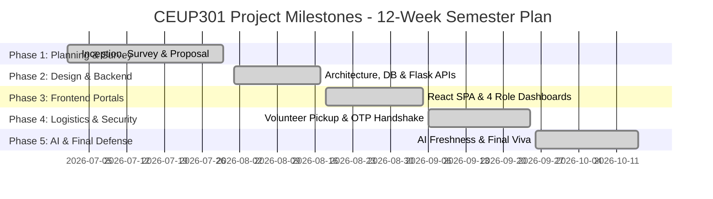

# Project Timeline & Milestones

**Project ID:** CS26006  
**Project Title:** Food Redistribution System: Real Life Solutions for Waste Management  
**Course Code:** CEUP301 (Project - I / SGP 3)  
**Academic Year:** 2026-2027 (Semester V)  
**Student Name:** Suyanshi Patel (24CS077)  
**Department:** Computer Science & Engineering, CHARUSAT  

---

## 📅 Semester V Weekly Execution Plan (12-Week Syllabus)

This timeline charts the systematic progression of **Project-I (CEUP301)** across the 12-week academic semester, mapped directly against faculty evaluation rubrics and university guidelines.

| Week # | Date / Duration | Phase / Module | Key Tasks & Deliverables | Status |
| :---: | :---: | :--- | :--- | :---: |
| **Week 1** | July 01 - July 07 | **Project Inception** | Problem identification in food waste and urban hunger. Formed core project concept and scope. | Completed |
| **Week 2** | July 08 - July 14 | **Literature Survey** | Analyzed Robin Hood Army, Feeding India, Olio. Drafted literature review and gap analysis matrix. | Completed |
| **Week 3** | July 15 - July 22 | **Requirement Analysis** | Formulated Functional (FRS) & Non-Functional (NFRS) requirements, hardware/software specifications. | Completed |
| **Week 4** | July 23 - July 30 | **Proposal Submission** | Prepared formal Project Proposal softcopy and submitted printed copy to mentor by **July 30, 2026**. Initialized GitHub repo `CS26006-Food-Redistribution-System`. | Completed |
| **Week 5** | Aug 01 - Aug 08 | **System Design & DB** | Designed 3-tier architecture, ER diagram, and relational database schema (`System_Architecture_Flowchart.jpg`). | Completed |
| **Week 6** | Aug 09 - Aug 17 | **Backend REST APIs** | Developed Python Flask RESTful backend with authentication, role permissions, and resilient in-memory fallback. | Completed |
| **Week 7** | Aug 18 - Aug 26 | **Frontend Architecture** | Bootstrapped React 18 + Vite SPA, implemented responsive UI components, navigation, and landing page. | Completed |
| **Week 8** | Aug 27 - Sept 05 | **Role Dashboards** | Developed dedicated dashboards for Donor (food listing) and NGO (claiming & tracking) portals. | Completed |
| **Week 9** | Sept 06 - Sept 15 | **Volunteer Logistics** | Implemented Volunteer dashboard, pickup assignment, and real-time status lifecycle (`Available` ➔ `Claimed` ➔ `In Transit`). | Completed |
| **Week 10** | Sept 16 - Sept 25 | **Secure OTP Handshake** | Built confidential 4-digit OTP generation for recipient NGO and verification modal for volunteer handoff. | Completed |
| **Week 11** | Sept 26 - Oct 05 | **AI Freshness Predictor** | Integrated Machine Learning freshness estimation model calculating safe consumption windows based on storage conditions. | Completed |
| **Week 12** | Oct 06 - Oct 15 | **Testing, Polish & Viva** | Conducted end-to-end integration testing, dashboard UI cleanup, finalized GitHub documentation & prepared for final evaluation. | Completed |

---

## 🎯 Key Milestones & Verification Criteria

---

## 📈 Evaluation Checklist (aligned with Faculty Rubric)

- [x] Repository named as per convention: `CS26006-Food-Redistribution-System`
- [x] Initial documentation committed (`README.md`, `PROBLEM_STATEMENT.md`, `LITERATURE_SURVEY.md`, `PROJECT_TIMELINE.md`, `REQUIREMENTS.md`, `.gitignore`)
- [x] Softcopy Project Proposal prepared for mentor sign-off (`PROJECT_PROPOSAL.md`)
- [x] Codebase separated into clean `frontend` and `backend` layers
- [x] Meaningful commit messages and continuous tracking throughout 12 weeks
- [x] Working prototype with AI predictor and Dual OTP Handshake
