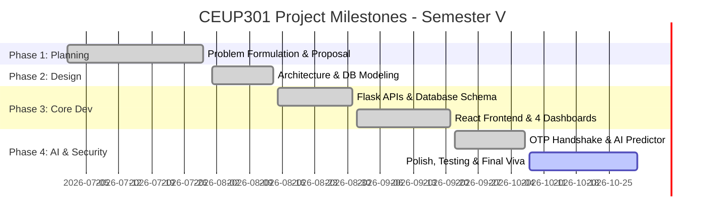

# Project Timeline & Milestones

**Project ID:** CS26006  
**Project Title:** Food Redistribution System: Real Life Solutions for Waste Management  
**Course Code:** CEUP301 (Project - I / SGP 3)  
**Academic Year:** 2026-2027 (Semester V)  
**Student Name:** Suyanshi Patel (24CS077)  
**Department:** Computer Science & Engineering, CHARUSAT  

---

## 📅 Semester V Weekly Execution Plan

This timeline charts the systematic progression of **Project-I (CEUP301)** across the 16-week academic semester, mapped directly against faculty evaluation rubrics and university guidelines.

| Week # | Date / Duration | Phase / Module | Key Tasks & Deliverables | Status |
| :---: | :---: | :--- | :--- | :---: |
| **Week 1** | July 01 - July 07 | **Project Inception** | Problem identification in food waste and urban hunger. Formed core concept. | Completed |
| **Week 2** | July 08 - July 14 | **Feasibility & Scope** | Evaluated technical feasibility (React, Flask, ML, MySQL). Defined user roles (Donor, NGO, Volunteer, Admin). | Completed |
| **Week 3** | July 15 - July 21 | **Literature Survey** | Analyzed Robin Hood Army, Feeding India, Olio. Drafted literature review and gap analysis. | Completed |
| **Week 4** | July 22 - July 30 | **Proposal Submission** | Prepared formal Project Proposal softcopy and submitted printed copy to mentor by **July 30, 2026**. Initialized GitHub repo `CS26006-Food-Redistribution-System`. | Completed |
| **Week 5** | Aug 01 - Aug 07 | **System Design & UML** | Designed 3-tier architecture, ER diagram, Use Case, Sequence, and Activity diagrams (`System_Architecture_Flowchart.jpg`). | Completed |
| **Week 6** | Aug 08 - Aug 14 | **Database Modeling** | Created relational schema (Users, Donations, Requests, OTP Logs) with SQLite / Mock in-memory fallback engine. | Completed |
| **Week 7** | Aug 15 - Aug 21 | **Backend API Development** | Built Flask RESTful API service with endpoints for authentication, role permissions, and batch creation. | Completed |
| **Week 8** | Aug 22 - Aug 31 | **Frontend Architecture** | Bootstrapped React 18 + Vite SPA, implemented responsive UI components, navigation, and landing page. | Completed |
| **Week 9** | Sept 01 - Sept 07 | **Role Dashboards** | Developed dedicated dashboards for Donor (food listing) and NGO (claiming & tracking). | Completed |
| **Week 10** | Sept 08 - Sept 14 | **Volunteer & Handshake** | Implemented Volunteer dashboard, pickup assignment, and real-time status synchronization. | Completed |
| **Week 11** | Sept 15 - Sept 21 | **Cryptographic OTP Handshake** | Built confidential 4-digit OTP generation for recipient NGO and verification modal for volunteer handoff. | Completed |
| **Week 12** | Sept 22 - Sept 30 | **AI Freshness Predictor** | Integrated Machine Learning freshness estimation model calculating safe consumption windows based on storage conditions. | Completed |
| **Week 13** | Oct 01 - Oct 07 | **Admin Audit & Analytics** | Created Administrator panel for user verification, platform metrics, and batch activity audits. | Completed |
| **Week 14** | Oct 08 - Oct 15 | **Integration & UI Polish** | Cleaned up user dashboard navigation, removed redundant links, tested full end-to-end donor-to-NGO cycle. | Completed |
| **Week 15** | Oct 16 - Oct 23 | **Testing & Documentation** | Conducted black-box and integration testing. Finalized all CEUP301 GitHub documentation artifacts. | In Progress |
| **Week 16** | Oct 24 - Oct 31 | **Final Viva & Defense** | Prepared 10-slide presentation deck, viva rehearsal, and final mentor review for Semester V evaluation. | Planned |

---

## 🎯 Key Milestones & Verification Criteria

---

## 📈 Evaluation Checklist (aligned with Faculty Rubric)

- [x] Repository named as per convention: `CS26006-Food-Redistribution-System`
- [x] Initial documentation committed (`README.md`, `PROBLEM_STATEMENT.md`, `LITERATURE_SURVEY.md`, `PROJECT_TIMELINE.md`, `REQUIREMENTS.md`, `.gitignore`)
- [x] Softcopy Project Proposal prepared for mentor sign-off (`PROJECT_PROPOSAL.md`)
- [x] Codebase separated into clean `frontend` and `backend` layers
- [x] Regular commits with descriptive messages
- [x] Verified working prototype with zero blocking errors
