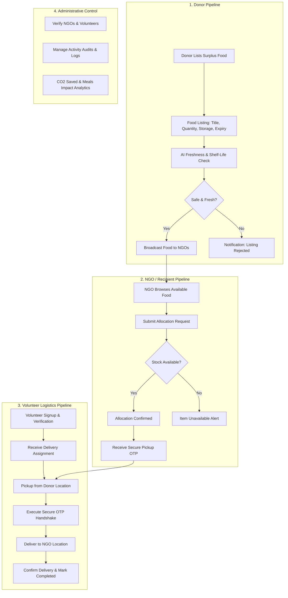

# Food Redistribution System (FRS) — System Architecture & Process Flow

### Cross-Functional Process Pipelines:

1. **Donor Pipeline**:
   - `Donor Lists Surplus` $\rightarrow$ `Surplus Food Listing (Description, Quantity, Expiry)` $\rightarrow$ `AI Freshness & Shelf-Life Check` $\rightarrow$ Decision `Safe & Fresh?`
   - **If Yes:** `Broadcast Food to NGOs`
   - **If No:** `Donor Notification & Listing Rejection`

2. **NGO / Recipient Pipeline**:
   - `NGO Discovers Broadcasted Items` $\rightarrow$ `Browse Food Database & View Details` $\rightarrow$ `Submit Allocation Request` $\rightarrow$ Decision `Inventory Availability?`
   - **If Yes:** `Notify NGO of Allocation Confirmation` $\rightarrow$ `Receive Secure OTP for Pickup`
   - **If No:** `Notification: Item Unavailable`

3. **Volunteer Logistics Pipeline**:
   - `Volunteer Signup & Verification` $\rightarrow$ `Receive Delivery Assignment` $\rightarrow$ `Arrive at Donor Location for Pickup` $\rightarrow$ `Execute Secure OTP Handshake` $\rightarrow$ `Deliver to NGO Destination` $\rightarrow$ `Confirm Delivery & Status Update`

4. **Administrative Control**:
   - `Volunteer & NGO Verification Dashboard` $\rightarrow$ `Comprehensive Activity Audits` $\rightarrow$ `Environmental Impact CO2 Analytics Reporting`

5. **Technology Stack**:
   - **Frontend**: React (Vite, Tailwind CSS, Lucide Icons)
   - **Backend**: Python Flask REST API & Gateway
   - **Persistence**: MySQL Relational Database & Real-time Persistence

